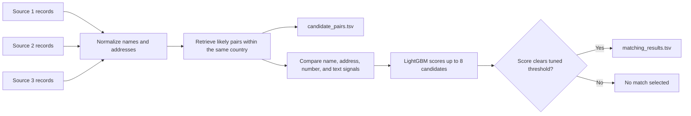

<div align="center">

<p><strong>APPLIED MACHINE LEARNING · PORTFOLIO PROJECT</strong></p>

<h1>Business Entity Resolution</h1>

<h3>Same business. Different records.</h3>

Link records for the same business across three sources, even when names and addresses are written differently.

<p>
  <a href="https://yakshini12.github.io/business-entity-resolution/">🌐 Explore the project page</a>
  ·
  <a href="#how-it-works">See how matching works</a>
</p>

<p>
  
  
  
</p>

</div>

<table>
  <tr>
    <th align="center">0.9520</th>
    <th align="center">95.44%</th>
    <th align="center">80 → 8</th>
  </tr>
  <tr>
    <td align="center">Macro F0.5 on a training-data holdout</td>
    <td align="center">Known matches retained in the shortlist</td>
    <td align="center">Candidates retrieved → candidates scored</td>
  </tr>
</table>

> **Validation result only.** Test labels were not supplied, so this is not a test score or leaderboard result. The threshold was selected on the same holdout, so the estimate may be optimistic.

## How it works

The system avoids comparing every possible pair. It first finds likely candidates within each country, then compares a small shortlist using name, address, number, and text-similarity signals.



## Candidate retrieval experiment

Wider retrieval brought more known matches into the eight-record scoring shortlist. The improvement from 60 to 80 was small, so the extra search cost may not be worthwhile for every deployment.

| Initially retrieved | Scored shortlist | Macro F0.5 | Known matches retained |
|:--:|:--:|--:|--:|
| 20 | 8 | 0.9467 | 94.36% |
| 40 | 8 | 0.9497 | 94.88% |
| 60 | 8 | 0.9514 | 95.20% |
| **80** | **8** | **0.9520** | **95.44%** |

The holdout used Iowa and Rajasthan records from the supplied training labels. Results may differ in other regions. See [EXPERIMENTS.md](EXPERIMENTS.md) for the comparison and validation details.

## What makes this useful

- **Scales beyond all-pairs matching:** candidate retrieval cuts down the number of pairs to compare.
- **Uses more than exact names:** normalization and pairwise signals account for common name and address variations.
- **Measured trade-offs:** retrieval widths were compared using the same holdout, including the cost of searching wider.
- **Works with large files:** country-wise processing, resumable training chunks, and disk-backed prediction shards help control memory use.
- **Reproducible locally:** challenge data stays outside the repository and is supplied by the user.

## Run it locally

The challenge dataset is hosted on [Kaggle](https://www.kaggle.com/datasets/patilayakshini/ml-challenge), but the files are **not stored in this GitHub repository**. The dataset license is currently **unknown**. Check the Kaggle listing and challenge terms before using or redistributing the records.

Download the files from Kaggle and arrange them like this, or pass the parent dataset folder with `--data-dir`:

<details>
<summary>Expected dataset layout</summary>

```text
dataset/
├── train/
│   ├── train_source1.tsv
│   ├── train_source2.tsv
│   ├── train_source3.tsv
│   └── train_ground_truth.tsv
└── test/
    ├── test_source1.tsv
    ├── test_source2.tsv
    └── test_source3.tsv
```

</details>

Install dependencies, train with the measured retrieval setting, predict, and check the output structure:

```bash
python -m pip install -r requirements.txt

python src/train.py \
  --data-dir dataset \
  --model-dir models/retrieve80 \
  --retrieve-k 80 \
  --model-k 8

python src/predict.py \
  --data-dir dataset \
  --model-dir models/retrieve80 \
  --out-dir output \
  --tmp-dir temp_predict

python src/check_outputs.py --out-dir output --test-dir dataset/test
```

The default training sample uses 3% of non-validation queries. The full feature set can need several gigabytes of RAM and disk; actual runtime depends on the machine and data size.

The checker validates row coverage, alignment, and output structure. It does not check every candidate ID against the source files, and the official challenge validator is not included.

## Project map

| File | Purpose |
|---|---|
| `src/normalize.py` | Clean business names and addresses |
| `src/blocking.py` | Retrieve likely candidate records |
| `src/features.py` | Build pairwise comparison signals |
| `src/train.py` | Train LightGBM and select a threshold |
| `src/predict.py` | Generate candidate and match TSV files |
| `src/check_outputs.py` | Check output structure locally |
| `EXPERIMENTS.md` | Validation setup and retrieval comparison |
| `docs/index.html` | Hosted visual project overview |

## Limits and next steps

- The reported metric comes from one training-data holdout and may be optimistic.
- No test labels were supplied, so test accuracy and leaderboard performance are unknown.
- Threshold tuning should be repeated across multiple geographic holdouts before relying on the score in a new region.
- Wider retrieval improves shortlist recall, but also increases search work.

No external business-record lookup is used. Challenge records and generated predictions are excluded from this repository. Check the challenge terms before selecting a license or redistributing the code.

<div align="center">

<strong><a href="https://yakshini12.github.io/business-entity-resolution/">Open the live project page</a> · <a href="https://github.com/yakshini12/business-entity-resolution">Browse the source</a></strong>

</div>
